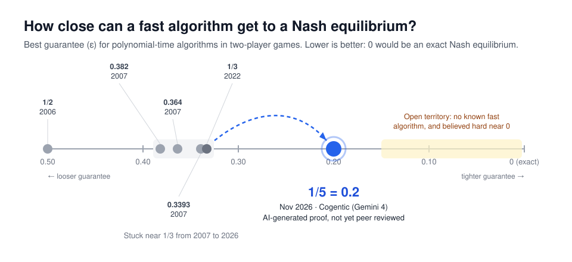

# What the new "1/5 Nash equilibrium" result means, in plain English

On **November 25, 2026**, Google Research published a set of papers written by **Cogentic**, an AI system for mathematical discovery that runs on Gemini 4. One of them builds directly on John Nash's most famous idea:

> **An Exact Polynomial-Time Algorithm for 1/5-Approximate Nash Equilibria in Bimatrix Games**
> [Paper (PDF)](https://github.com/google-research/google-research/blob/4a7bc8ab0bc7/cogentic_research_papers/bimatrix_nash_equilibrium/paper.pdf) · [Folder README](https://github.com/google-research/google-research/tree/4a7bc8ab0bc7/cogentic_research_papers/bimatrix_nash_equilibrium) · [All Cogentic papers](https://github.com/google-research/google-research/tree/4a7bc8ab0bc7/cogentic_research_papers)

This repo explains what that paper claims, why it matters, and what it does *not* claim.

---

## The one-paragraph version

In 1950, John Nash proved that every game has an equilibrium: a set of strategies where no player gains by changing theirs alone. Nobody knows a *fast* way to find one exactly, and there are strong reasons to believe none exists. So researchers ask a softer question: **how close can a fast algorithm get?** From 2007 to 2026 the best answer stayed at about **one third**. The new paper claims a fast algorithm that always gets within **one fifth**. That is the biggest jump on this problem in almost twenty years.

---

## 1. Nash's original idea (1950)

Picture two players. Each picks a strategy, possibly at random (a "mixed strategy"), and each gets a payoff that depends on both choices.

A **Nash equilibrium** is a pair of strategies where **neither player can do better by switching on their own.** Nash proved in his 1950 PhD thesis that such a point always exists in any finite game. This idea became the base of modern game theory and won him the 1994 Nobel Prize in Economics.

The catch: Nash's proof shows an equilibrium *exists*, but gives no fast recipe for *finding* one.

## 2. Why finding one is hard

In 2006, Daskalakis, Goldberg and Papadimitriou, and then Chen and Deng (for two players), showed that finding a Nash equilibrium is **PPAD-complete**. In plain terms, it belongs to a class of search problems that computer scientists widely believe have no fast (polynomial-time) algorithm.

So if you want a fast method, you have to accept an *approximate* answer.

## 3. What "approximate" means here (the ε number)

Scale every payoff so it sits between 0 and 1. Then for any pair of strategies, ask:

> *How much could either player gain by switching to their best alternative?*

That gain is called **regret**. A profile is an **ε-approximate Nash equilibrium** if neither player's regret is more than ε.

| ε | What it means |
|---|---|
| 0 | A true Nash equilibrium. Nobody gains anything by switching. |
| 1/3 ≈ 0.33 | Someone might gain up to a third of the payoff range by switching. |
| **1/5 = 0.2** | **Nobody can gain more than a fifth of the payoff range.** |
| 1/2 | Easy. A simple trick has always achieved this. |

Smaller ε means closer to Nash's ideal.

## 4. The race, 2006 to 2026

| Year | Guarantee (ε) | Who | Approach |
|---|---|---|---|
| 2006 | 1/2 | Daskalakis, Mehta, Papadimitriou | Simple best-response mixing |
| 2007 | 0.382 | Daskalakis, Mehta, Papadimitriou | Linear programming plus mixing |
| 2007 | 0.364 | Bosse, Byrka, Markakis | Zero-sum game trick plus mixing |
| 2007 | 0.3393 | Tsaknakis, Spirakis | Steepest descent on regret |
| 2022 | 1/3 | Deligkas, Fasoulakis, Markakis | Refined steepest descent |
| **2026** | **1/5** | **Cogentic (AI) / Google Research** | **New "kite" linear programs** |

*ε values come from Table 1 of the new paper. Years are when each result first appeared.*

For about two decades the best guarantee sat between 0.34 and 0.33. The new result moves it to 0.20, and the paper notes it is **exact** at 1/5, not "1/5 plus a tiny bit".

## 5. How the new algorithm works (at a high level)

The paper calls the algorithm **MaximinKiteNE**.

1. **Safety check.** Compute each player's guaranteed "security" payoff, as if the game were zero-sum. If both are already at most 1/5, output that and stop.
2. **Kite steps.** Otherwise, run a fixed number of linear programs. Each mixes in a cautious "maximin" strategy at weight 1/4 and searches inside a geometric region the authors call a **1/5-kite**. Any strategy pair whose regrets land in that kite can be turned into a 1/5-equilibrium directly.
3. **Why it must stop.** The proof shows that if the loop ever failed to stop, a certain continuous system (a Volterra integral inequality, analyzed with Fourier methods) would force a quantity to be at least −2⁻¹⁴. Exact computer algebra then shows that quantity is always at most −1/3000. The two can't both hold, so the algorithm always halts with a valid answer.

The paper doesn't use the steepest-descent methods that earlier work relied on.

## 6. Who did this: the AI angle

According to the paper and its README:

- The **entire paper was produced by Cogentic**, an agentic AI framework running on **Gemini 4**.
- There was **no human interaction** beyond the first prompt asking for a full proof and formalization.
- A full **Lean 4 formal proof** (computer-checked, using only the Mathlib library) has been completed and is **due in a companion release**.
- The Cogentic harness was built by Yang Cai, Vineet Gupta, Yanchen Jiang, Christopher Liaw, Aranyak Mehta, Grigoris Velegkas, and Di Wang at Google Research and Google DeepMind.

## 7. What to keep in mind

- **Not yet peer reviewed.** The paper is newly posted. The Lean proof, once released, would be strong evidence that it's correct, but that proof hasn't been published yet.
- **Theory, not a practical tool.** The authors say so directly: the constants are "astronomically large". The algorithm runs about 3 · 2⁵⁶ internal scales. It is polynomial-time in the formal sense, but nobody will run it on a laptop. Its value is in proving that 1/5 is achievable.
- **Doesn't settle the big question.** Finding an *exact* Nash equilibrium fast is still believed to be impossible. The best possible fast ε (somewhere between 0 and 1/5) is still unknown.
- **Two-player games only.** The result covers "bimatrix" games with payoffs scaled to [0, 1].

## 8. Other Nash-related papers in the same release

Cogentic also produced two other game-theory papers that touch Nash-style equilibria:

- **[Polynomial Dimension Dependence for Fictitious Play Convergence](https://github.com/google-research/google-research/tree/4a7bc8ab0bc7/cogentic_research_papers/fictitious_play_convergence)** (Nov 23, 2026). Fictitious play is a classic method (Brown and Robinson, 1951) where players repeatedly best-respond to each other's history. This paper builds games where it converges very slowly, answering an open question about how slowness scales with game size. Abernethy, Lazarsfeld and Wibisono found a matching result independently.
- **[Intractability of Approximate Correlated Equilibria in Two-Player Convex Games](https://github.com/google-research/google-research/tree/4a7bc8ab0bc7/cogentic_research_papers/ce_convex_games)** (Oct 30, 2026). This one shows that a relaxed equilibrium notion (correlated equilibrium) is still hard to compute in continuous "convex" games. It resolves an open question from Anagnostides et al.

## Glossary

- **Bimatrix game.** A two-player game given by two payoff tables, one per player.
- **Mixed strategy.** Choosing among actions at random with fixed probabilities.
- **Regret.** How much a player would gain by switching to their best response.
- **ε-Nash equilibrium.** A profile where every player's regret is at most ε.
- **Polynomial time.** Running time that grows like a polynomial in the input size. This is computer science's working definition of "efficient in principle".
- **PPAD.** A class of search problems where a solution is guaranteed to exist but is believed hard to find. Exact Nash belongs here.
- **Lean 4 / Mathlib.** A proof assistant and its math library. A Lean proof is checked line by line by a computer.

---

### Sources

- Cogentic, [*An Exact Polynomial-Time Algorithm for 1/5-Approximate Nash Equilibria in Bimatrix Games*](https://github.com/google-research/google-research/blob/4a7bc8ab0bc7/cogentic_research_papers/bimatrix_nash_equilibrium/paper.pdf), Google Research, Nov 2026 (CC-BY-4.0)
- [Cogentic research papers index](https://github.com/google-research/google-research/tree/4a7bc8ab0bc7/cogentic_research_papers)
- Cogentic framework: [arXiv:2609.40324](https://arxiv.org/abs/2609.40324)
- J. Nash, "Equilibrium points in n-person games," *PNAS*, 1950
- [Britannica: John Nash](https://www.britannica.com/biography/John-Nash) · [MacTutor: John Forbes Nash](https://mathshistory.st-andrews.ac.uk/Biographies/Nash/)

*This is an independent explainer. It is not affiliated with Google, and it does not reproduce the paper. Read the original for the full proof.*
